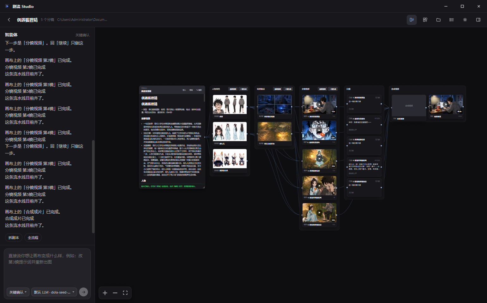

# 剧流 Studio

> 本地优先、模型自由接入的开源 AI 视频创作工作台。

[](https://github.com/JerrIsTheBesta/AI-Short-Drama-Studio/releases/latest)
[](LICENSE)
[](https://vuejs.org/)
[](https://www.electronjs.org/)


剧流 Studio 把剧本、角色、场景、分镜、图片、视频、配音、音乐和最终合成放进一张可视化画布。你可以让智能体推进完整创作，也可以随时修改节点、连接素材、替换模型或只重做其中一步。

项目不绑定某一家 AI 服务。语言模型、视觉理解、生图、视频、配音和音乐都可以使用不同厂商、中转站、本地 ComfyUI 或自定义工作流。

## 直接下载

不想配置开发环境的 Windows 用户，可以直接下载安装包：

### [下载最新版剧流 Studio](https://github.com/JerrIsTheBesta/AI-Short-Drama-Studio/releases/latest)

在 Release 页面下载 `Studio.Setup.*.exe`，双击安装即可，无需安装 Node.js、npm 或 FFmpeg。

> 安装包暂未购买代码签名证书。如果 Windows SmartScreen 提示风险，请确认文件来自本项目 GitHub Releases，再选择“更多信息 → 仍要运行”。

## 一张画布完成整个创作



现在不再区分“普通创作”和“自由画布”。新建项目后会直接进入统一画布：

- 想自动完成：告诉左侧智能体你要做什么，它可以规划、创建节点、连接素材并推进流程。
- 想精细控制：直接编辑剧本、分镜、提示词、模型、参考图、时长和节点连接。
- 已经有素材：把图片、视频、音频或 Markdown 剧本导入画布，从任意步骤开始。
- 只想走传统流程：仍可使用经典步骤导航，依次完成文案、分镜、配图、视频、剪辑与导出。

所有节点都可以检查、修改和局部重做，不必因为一个镜头失败而重新生成整个项目。

## 核心能力

### AI 创作智能体

- 根据自然语言判断本轮任务，生成计划并调用画布工具。
- 创建、连接、删除、重命名和整理节点，支持项目体检与失败续跑。
- 可记住本地创作偏好，回复支持富文本、计划卡片、执行轨迹和可复制提示词。
- 创作偏好集中设置画幅、图片模型和视频模型，单个节点仍可覆盖。

### 本地剧本库

- AI 生成的剧本自动保存为 Markdown，桌面端存放在项目根目录的 `_scripts/`。
- 支持分集编辑、Markdown 源码与排版预览、插入、删除、排序、导入和导出。
- 可以在剧本库中直接让 AI 写作，完成后送入任意项目继续制作。

### 专业分镜与提示词

- 从剧本提取角色、场景和镜头，并按视频模型允许的时长规划每个镜头。
- 描述镜头内的动作时间轴、站位、视线、表演、运镜、对白和环境声音。
- 支持单镜头优化与批量队列优化，生成结果始终可见、可编辑。
- 支持人物身份、场景、故事看板、首尾帧和多图参考关系。

### 图片、视频与声音

- 生成人设图、角色卡、场景图、分镜图、故事看板和关键帧。
- 支持 H3、万相、APIMart、AutoDL、Zealman、本地/云端 ComfyUI 及自定义接口。
- 支持参考图视频、首尾帧视频、任务轮询、失败恢复和批量处理。
- 角色卡可配置音色描述和参考音频，按“角色名：台词”匹配配音与声音复刻。

### 剪辑与导出

- 导入本地视频、音乐、字幕和文字，也可直接使用项目生成素材。
- 支持片段排序、左右裁切、速度、音量、转场、音乐轨、字幕和文字轨。
- 可选择保留镜头原声或去除原声，再与对白、环境音和配乐合成。
- 使用 FFmpeg.wasm 在本机完成拼接、混音、字幕烧录和导出。

## 三步开始使用

1. 安装并打开应用，在“设置 → 语言模型”配置一套可用 LLM。
2. 打开“接入助手”，粘贴其他服务的 API 文档，让助手配置视觉、生图、视频、配音等能力。
3. 回到首页点击“新建”，直接告诉画布左侧智能体你想制作的视频。

新手推荐阅读：[第一次使用教程](docs/教程-第一次用.md)

> AI 服务的账号、API Key 和额度需要用户自行准备。仓库及公开安装包不包含任何真实 Key。

## 模型与服务接入

每类能力都可以保存多套配置，并在项目或节点中切换：

- 语言模型：OpenAI Chat Completions 兼容接口、官方厂商或中转站。
- 视觉理解：参考图分析、人物与场景提取、画面质检。
- 图片生成：OpenAI 图片兼容接口、Seedream、APIMart、ComfyUI 与自定义接口。
- 视频生成：AutoDL、Zealman、APIMart、万相、本地/云端 ComfyUI 与自定义工作流。
- 配音与音乐：TTS、参考音频复刻、环境声音和配乐服务。

建议先配置语言模型，再把公开 API 文档交给接入助手。私人 Key 最好在对应设置页面手动填写，不要粘贴到不可信的第三方对话中。

## 从源码运行

### 环境要求

- Node.js 20+
- npm 10+
- Windows 10/11（Electron 桌面版）

### 安装

```bash
git clone https://github.com/JerrIsTheBesta/AI-Short-Drama-Studio.git
cd AI-Short-Drama-Studio
npm install
```

下载本地 FFmpeg 核心：

```bash
# 国际网络
node scripts/download-ffmpeg-core.cjs

# 中国大陆镜像
node scripts/download-ffmpeg-core.cjs --source=npmmirror
```

启动开发环境：

```bash
npm run dev
```

只运行 Web 版本：

```bash
npm run web
```

## 构建 Windows 安装包

```bash
npm run electron:build
```

安装包会生成到 `release/`。构建流程会自动执行类型检查、源码凭据扫描、生产构建和打包内容检查。

也可以分别执行：

```bash
npm run type-check
npm run security:check
npm run build
```

## 数据存储与隐私

- 桌面端默认将项目保存在“文档/AI-Cut”，也可以在设置中修改素材根目录。
- 每个项目拥有独立目录和 `project.json`；剧本、图片、视频和音频均保存在本地。
- Web 版使用 IndexedDB；清理浏览器站点数据前请先导出重要内容。
- 必要的提示词和素材会发送给用户自行配置的第三方 AI 服务，其数据政策由对应服务商决定。
- `.env`、私钥和常见凭据文件默认被 Git 忽略，发布前还会扫描源码与构建产物。

详细说明：[安全策略](SECURITY.md) · [项目架构](ARCHITECTURE.md) · [完整功能](FEATURES.md)

## 技术栈

Vue 3 · TypeScript · Pinia · Vue Flow · Electron · FFmpeg.wasm

```text
src/
├─ components/   画布节点、智能体、设置与时间线组件
├─ services/     AI 接口、画布编排、存储与 FFmpeg
├─ stores/       项目、剧本、素材与设置状态
├─ types/        项目、节点、任务与时间线类型
└─ views/        首页、统一画布、剧本库、剪辑与设置页面
```

## 参与开发

欢迎提交 Issue 和 Pull Request。新增模型或服务时，请把协议差异封装在 `src/services/ai/`，不要在源码、日志或截图中提交真实凭据。

- [贡献指南](CONTRIBUTING.md)
- [更新日志](CHANGELOG.md)
- [最新版本](https://github.com/JerrIsTheBesta/AI-Short-Drama-Studio/releases/latest)

## License

[MIT License](LICENSE)
