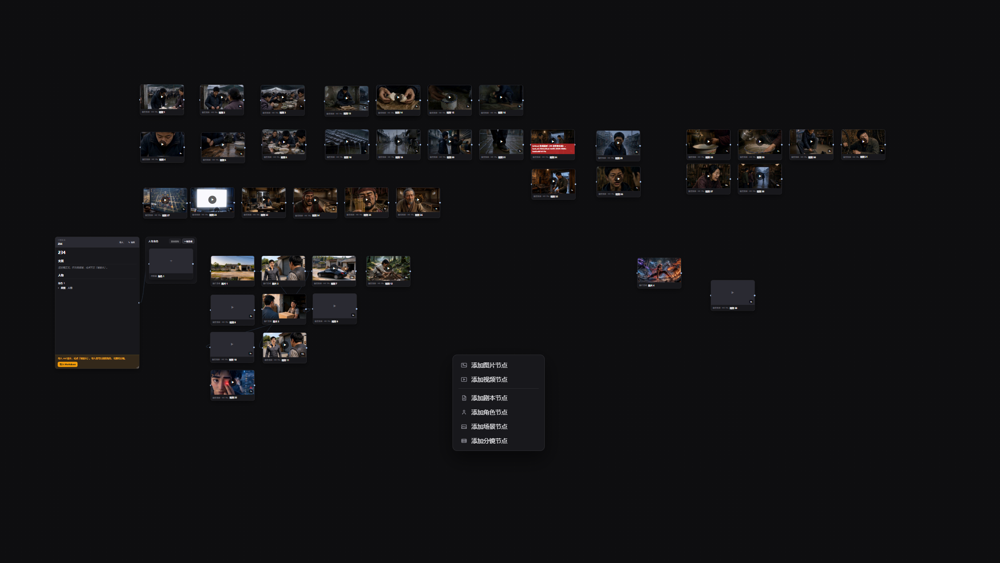

# 剧流 Studio

剧流 Studio 是一款本地优先、模型可自由接入的 AI 视频创作与剪辑工作台。它把剧本、人物设定、场景、分镜、参考图、视频、对白、音乐和最终合成放进同一个可视化项目，也可以不使用 AI，直接导入本地素材完成基础视频剪辑。


上图展示了完整的画布式生产流程：左侧智能体负责理解和推进任务，右侧节点把剧本、人物设定、场景图、分镜视频、口播和最终合成连接成一条可检查、可修改、可局部重做的流水线。

## 打造专属于你的视频工作台

剧流 Studio 不绑定单一模型或单一服务商。你可以按照自己的预算、地区、画面风格和制作习惯，自由接入并组合各种 AI 能力：

- 接入不同厂商或中转服务提供的 LLM，用于写剧本、拆分镜、画布智能体和提示词优化。
- 接入具备看图能力的视觉模型，用于识别参考图、提取人物与场景信息和进行画面质检。
- 接入不同风格和质量档位的生图模型，用于人设图、场景图、故事看板和分镜关键帧。
- 接入 H3、万相以及其他自定义视频模型或工作流，完成图生视频和首尾帧生成。
- 接入 TTS、声音克隆和音乐模型，完成对白、旁白、音色与配乐生产。
- 每类能力都可以保存多套服务和多个模型，在不同项目或节点中按需切换。

只需先配置一套可用 LLM，再把其他服务的 API 文档交给接入助手，便可以逐步搭建一套由你选择模型、由你掌握素材和流程的视频生产工作台。

项目使用 Vue 3、TypeScript、Vue Flow、Electron 和 FFmpeg.wasm 构建，当前主要面向 Windows 桌面端与现代桌面浏览器。

> 项目仍在持续开发。AI 模型需要用户自行申请和配置，本仓库及公开构建不得包含任何真实 API Key。

## 目录

- [能做什么](#能做什么)
- [工作模式](#工作模式)
- [环境要求](#环境要求)
- [安装与运行](#安装与运行)
- [配置 AI 服务](#配置-ai-服务)
- [使用方法](#使用方法)
- [构建桌面安装包](#构建桌面安装包)
- [项目架构](#项目架构)
- [数据存储](#数据存储)
- [安全与隐私](#安全与隐私)
- [常见问题](#常见问题)
- [参与开发](#参与开发)

## 能做什么

### 剧本与分镜

- 从主题生成结构化剧本，也可以手动编写或导入 Markdown。
- 管理多章节、背景设定、人物说明、场景环境、动作、对白、旁白和视听基调。
- 从剧本提取人物、场景和分镜，支持局部重新提取。
- 按镜头时长描述每个时间段的人物动作、表情、视线、对白、站位、运镜和现场声音。
- 可直接修改模型生成的剧本、分镜和提示词。

### 无限画布与智能体

- 在无限画布上组织剧本、人物、场景、图片、视频、音频和导出节点。
- 通过节点连线把上游图片作为下游生成节点的参考图。
- 画布智能体可读取当前项目，协助修改剧本、拆分镜、调整提示词及运行节点。
- 提示词智能体可针对当前选中的图片或视频节点扩写提示词，并参考用户粘贴的剧本。
- 支持切换语言模型，优化后的提示词仍然对用户完整可见和可编辑。

### 接入助手（配置助理）

- 用户只需要先手动配置一套可用的语言模型，其他 AI 能力可以交给接入助手配置。
- 可把视觉理解、图片生成、视频生成、TTS、音乐服务或中转站的 API 文档直接粘贴给接入助手。
- 接入助手会阅读文档，提取服务地址、接口类型、鉴权方式、模型名称、工作流 ID 和其他必要参数。
- 解析完成后会把配置写入对应能力，用户检查并保存后即可在画布节点和模型下拉框中使用。
- 支持常规服务商，也支持 OpenAI 兼容接口、自定义网关和第三方中转站。
- 不同能力可以来自不同厂商，并在同一个项目中协同工作，例如使用一种 LLM 写分镜、另一种视觉模型看图、另一种生图模型做人设，再交给自定义视频模型生成成片。

### 图片与参考资源

- 生成人物设计图、场景图、故事看板和分镜关键帧。
- 支持文生图、多图参考和已有资源复用。
- 参考图可以上传、从资源库选择、调整顺序或单独移除。
- 区分人物身份参考、场景空间参考、故事看板和额外用户参考。
- 生成结果自动进入项目资源库，可直接绑定节点，不必反复生成。

### AI 视频

- 支持参考图生成和首尾帧生成。
- 支持 H3、H3 V5、万相 Prime 及可配置的自定义视频工作流。
- 根据模型限制处理参考图、生成时长和分辨率。
- H3 提示词支持按秒动作、对白顺序、人物主次、表情、视线、运镜和声音描述。
- 支持任务轮询、失败重试、任务恢复和生成结果地址检查。

### 配音、字幕、音乐与剪辑

- 从分镜对白生成或编辑字幕，也支持 SRT 导入、导出。
- 支持 TTS、音色选择、逐段语音生成和相关声音克隆流程。
- 可导入本地视频和音乐，或使用项目已经生成的素材。
- 视频片段支持预览、排序、裁切入点、时长、速度、音量和转场。
- 视频、音乐和文字使用独立轨道。
- 文字可设置内容、字体、字号、颜色、粗细、出现时间和持续时长。
- 文字可直接在视频画面中拖动，导出时使用实际位置。
- FFmpeg.wasm 在本机完成拼接、混音、字幕烧录和最终视频导出。

完整功能清单见 [FEATURES.md](FEATURES.md)。

## 工作模式

### 普通视频项目

适合从零制作剧情短片或一般视频：

```text
剧本 → 人物与场景 → 分镜 → 图片 → 视频 → 配音与字幕 → 视频剪辑 → 导出
```

### 视频复刻

上传一条参考视频和至少一张产品图，分析原视频镜头，再生成可编辑的复刻流程。产品、人物和场景仍需人工检查，避免模型错误替换。

### 自由模式

从空白画布开始，右键添加剧本、图片或视频节点。适合已经有部分素材、只想自由连接参考关系的用户。



自由模式不强制用户遵循固定流水线。素材可以按剧情、章节或用途自由排列；在画布空白处打开菜单，即可继续添加图片、视频、剧本、角色、场景和分镜节点。

### 智能口播

导入真人口播视频和文案，完成分段生产、视觉包装、字幕处理、质检和导出。

### 视频剪辑

不创建完整 AI 流程，直接从首页进入“视频剪辑”，导入本地视频、音乐和文字后合成。

## 环境要求

- Node.js 20 或更高版本。
- npm 10 或兼容版本。
- Windows 10/11 用于 Electron 桌面版；Web 开发也可在其他系统运行。
- Chrome、Edge 或 Firefox 的较新版本。
- 足够的内存和磁盘空间。FFmpeg.wasm 处理长视频或高分辨率素材时消耗较高。
- 使用真实 AI 功能时，需要对应服务商的账号、API Key 和可用额度。

## 安装与运行

### 1. 获取代码

```bash
git clone <repository-url>
cd ai-cut
```

### 2. 安装依赖

```bash
npm install
```

### 3. 下载本地 FFmpeg 核心（推荐）

FFmpeg 核心约 30 MB，因此没有提交进 Git。国际网络可以运行：

```bash
node scripts/download-ffmpeg-core.cjs
```

中国大陆网络可使用镜像：

```bash
node scripts/download-ffmpeg-core.cjs --source=npmmirror
```

文件会放入 `src/assets/ffmpeg/`。如果不下载，应用会尝试使用 CDN。详细说明见 [public/ffmpeg/README.md](public/ffmpeg/README.md)。

### 4. 启动开发环境

```bash
npm run dev
```

默认是演示模式，不需要 API Key，可以先体验界面、画布和流程。

只运行 Web 模式：

```bash
npm run web
```

## 配置 AI 服务

推荐启动应用后先进入“设置 → 语言模型”，手动配置一套可用的 LLM。然后进入“设置 → 接入助手”，把其他服务商的 API 文档粘贴进去，由接入助手完成剩余配置。

### 使用接入助手自动配置

1. 先配置语言模型的服务地址、API Key 和模型名称并保存。
2. 打开“接入助手”。
3. 选择“从文档接入”，粘贴服务商或中转站提供的 API 文档。
4. 告诉助手需要配置的能力，例如视觉理解、图像生成、视频、TTS 或音乐。
5. 助手会解析接口地址、请求协议、鉴权、模型列表和工作流参数，并写入对应配置。
6. 打开助手给出的配置页面，检查内容后保存并测试。

因此，用户不需要逐项理解所有厂商参数。只要先接通一个 LLM，就可以把其余接入文档交给配置助理处理。每种能力仍可保存多套接入和多个模型。

> 建议先粘贴不包含私人凭据的公开 API 文档，让助手生成配置结构，再在对应配置页填写 Key。若把第三方 Key 一并发给接入助手，该内容会经过当前配置的语言模型服务。

也可以通过本机环境文件提供默认值：

Windows PowerShell：

```powershell
Copy-Item .env.example .env
```

macOS/Linux：

```bash
cp .env.example .env
```

然后只在 `.env` 中填写自己的配置：

```dotenv
VITE_AI_REAL_MODE=true

VITE_LLM_BASE_URL=https://api.example.com/v1
VITE_LLM_API_KEY=your-api-key
VITE_LLM_MODEL=your-model
```

可配置的能力包括：

- `VITE_LLM_*`：剧本、分镜、画布智能体和提示词优化。
- `VITE_VISION_*`：参考图分析和画面质检。
- `VITE_IMAGE_*`：人物、场景、看板和分镜图生成。
- `VITE_VIDEO_*`：视频生成地址、令牌、模型或工作流。
- `VITE_TTS_*`：对白与旁白语音合成。
- `VITE_MUSIC_*`：AI 配乐生成。

不同服务商的接口并不完全一致。语言模型主要使用 OpenAI Chat Completions 兼容格式；图像、视频、TTS 和音乐服务在 `src/services/ai/` 中分别适配。

## 使用方法

### 制作一条完整视频

1. 在首页创建项目并选择画幅。
2. 在剧本节点中输入主题、生成剧本，或导入现有 Markdown 剧本。
3. 提取人物和场景，检查年龄、外形、服装、时代与环境信息。
4. 提取分镜，逐镜确认时长、人物站位、动作、表情、视线、对白与运镜。
5. 生成人设图和场景图，也可以从资源库选择已有参考图。
6. 按所选视频模型生成必要的看板或关键帧。
7. 打开视频节点，检查实际提交提示词和“图1、图2……”参考映射后再生成。
8. 在字幕或配音页面处理对白、旁白和声音。
9. 进入视频剪辑页调整片段顺序，加入音乐和可拖动文字。
10. 预览无误后执行最终合成和导出。

### 只做视频剪辑

1. 首页点击“视频剪辑”。
2. 导入一个或多个本地视频。
3. 点击缩略图预览，拖动播放头定位。
4. 调整视频顺序、裁切、速度、音量和转场。
5. 在音乐轨投入本地音乐并设置开始时间、入点、长度和音量。
6. 在播放头位置添加文字，在预览画面中拖到需要的位置。
7. 确认后合成并导出。

## 构建桌面安装包

先执行检查：

```bash
npm run type-check
npm run security:check
npm run build
```

构建 Windows Electron 安装包：

```bash
npm run electron:build
```

输出目录为 `release/`。

构建命令会自动执行两类安全检查：

- 扫描 Git 跟踪源码中的疑似硬编码凭据。
- 检查 `dist` 和 `dist-electron` 是否混入当前机器 `.env` 中的真实值。

## 项目架构

### 数据流

```text
剧本 Script
   ↓ LLM 提取与拆分
人物 Subject + 场景 Scene + 分镜 Shot[]
   ↓ 图片/视频/TTS 服务
素材 Asset[]
   ↓ 时间线编排
TimelineClip[] + AudioTimelineClip + TextOverlay[]
   ↓ FFmpeg.wasm
最终视频
```

人物、场景和分镜保存业务描述；图片、视频和音频保存为素材；画布节点保存流程关系；时间线只负责最终播放顺序和合成参数。

### 分层结构

```text
views / components
        ↓
Pinia stores
        ↓
services
  ├─ ai       外部 AI 接口与提示词逻辑
  ├─ canvas   节点布局、智能体工具、任务与流程编排
  ├─ ffmpeg   裁切、转场、拼接、混音和字幕烧录
  └─ storage  Electron 文件系统与浏览器 IndexedDB
        ↓
types         项目、素材、画布、时间线与任务类型
```

### 主要目录

```text
src/
├─ components/
│  ├─ canvas/          画布节点、画布智能体和提示词智能体
│  ├─ common/          按钮、卡片、资源选择器等通用组件
│  ├─ layout/          顶栏与工作流导航
│  ├─ settings/        AI 接入配置组件
│  └─ timeline/        视频时间线组件
├─ services/
│  ├─ ai/              LLM、视觉、图片、视频、TTS、音乐
│  ├─ canvas/          画布运行器、任务、节点工具和最终导出
│  ├─ ffmpeg/          FFmpeg.wasm 封装
│  └─ storage/         本地持久化
├─ skills/             内置剧本、分镜、图片、视频和质检规范
├─ stores/             项目、素材、设置、公共资源库和通知
├─ types/              TypeScript 数据模型
└─ views/              首页、画布、分镜、剪辑、字幕、导出等页面
electron/
├─ main.ts             Electron 主进程、文件和网络桥接
├─ preload.ts          安全暴露桌面能力
└─ sqlite.ts           桌面端本地设置数据库
scripts/               下载、诊断、构建和安全检查工具
```

更深入的说明见 [ARCHITECTURE.md](ARCHITECTURE.md)。

## 数据存储

### Electron 桌面端

- 默认根目录：用户“文档/AI-Cut”。
- 每个项目拥有独立目录和 `project.json`。
- 图片、视频、音频和缩略图保存在项目素材目录。
- 应用设置保存在本机 SQLite 数据库中。
- 公共图片资源位于 `_library` 目录。

### Web 模式

- 项目和素材保存在 IndexedDB。
- 应用设置和少量界面状态保存在 localStorage。
- 浏览器清理站点数据会删除这些内容，重要项目应及时导出备份。

## 安全与隐私

- 仓库不附带任何可用 API Key。
- `.env`、`.env.*`、私钥、证书和常见凭据文件默认被 Git 忽略。
- 不要把真实 Key 写进 `.env.example`、源码、Issue、日志或截图。
- Vite 的 `VITE_*` 变量可能进入前端构建产物；公开安装包必须使用空 Key 构建。
- API 请求会把必要的提示词或素材发送给用户配置的第三方服务，第三方如何保存数据取决于其服务条款。

完整安全说明见 [SECURITY.md](SECURITY.md)。

## 常见问题

### 没有配置 Key 能运行吗？

可以。默认演示模式用于体验界面和调试流程，但不会产出真实 AI 内容。

### 为什么 FFmpeg 加载失败？

优先运行本地核心下载脚本。Web 模式还要求正确的 COOP/COEP 响应头，项目的 Vite 配置已经提供开发环境所需响应头。

### 为什么视频生成成功但没有视频地址？

部分第三方工作流会返回成功状态但不给结果文件。应用会把它视为无有效产物；需要检查服务端任务结果结构、输出节点和文件访问权限。

### 为什么生成很慢或经常失败？

先在设置页确认地址、Key、模型或工作流 ID；再检查模型额度、网络和第三方服务日志。长剧本建议分章节和分批生成，完成的节点会保留。

### 为什么桌面版打包时出现 `EPERM`？

通常是旧的 `release/win-unpacked.tmp` 被正在运行的应用、资源管理器预览、杀毒软件或另一个打包进程占用。完全退出相关进程后再构建。

### 可以直接发布构建出的安装包吗？

发布前至少运行 `npm run security:check` 和 `npm run build`，确认构建环境没有注入私人 Key，并实际安装测试一次。

## 参与开发

```bash
npm run type-check
npm run security:check
npm run build
```

欢迎提交 Issue 和 Pull Request。新增模型或服务时，请把服务差异封装在 `src/services/ai/`，不要在 UI 组件中写死私人地址、项目提示词或凭据。

贡献规范见 [CONTRIBUTING.md](CONTRIBUTING.md)。

## 已知限制

- AI 输出必须人工审核，特别是人物一致性、场景连续性、对白时序和镜头方向。
- FFmpeg.wasm 受设备性能和浏览器内存限制，长视频更适合原生 FFmpeg。
- 第三方模型接口和工作流可能变化，需要同步适配。
- 当前桌面安装包主要针对 Windows。

## License

本项目使用 [MIT License](LICENSE)。
